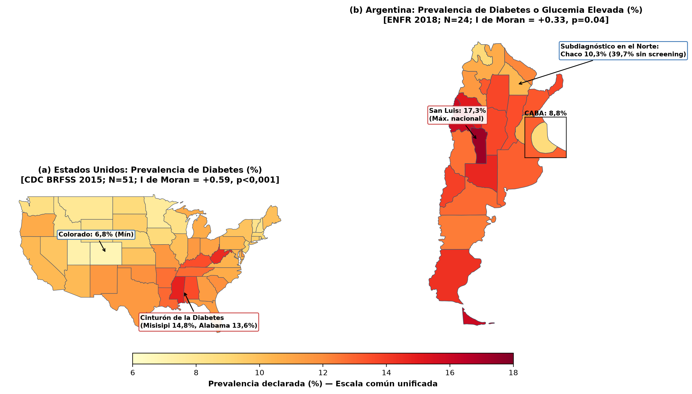
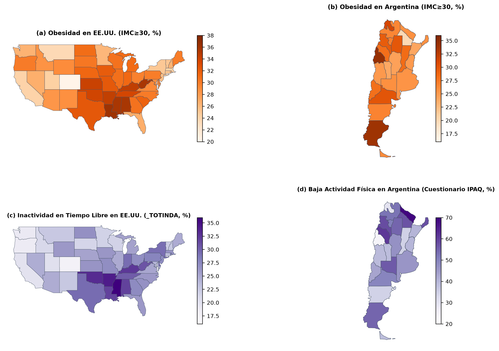
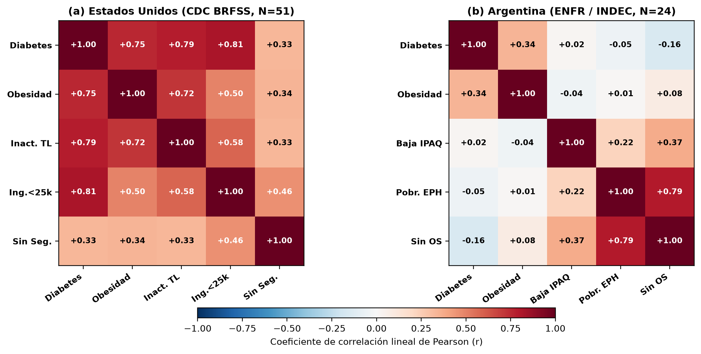
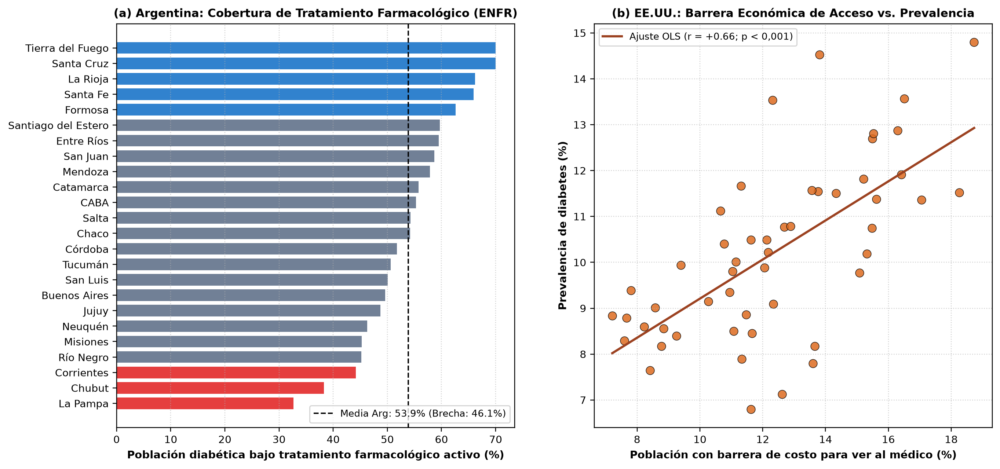
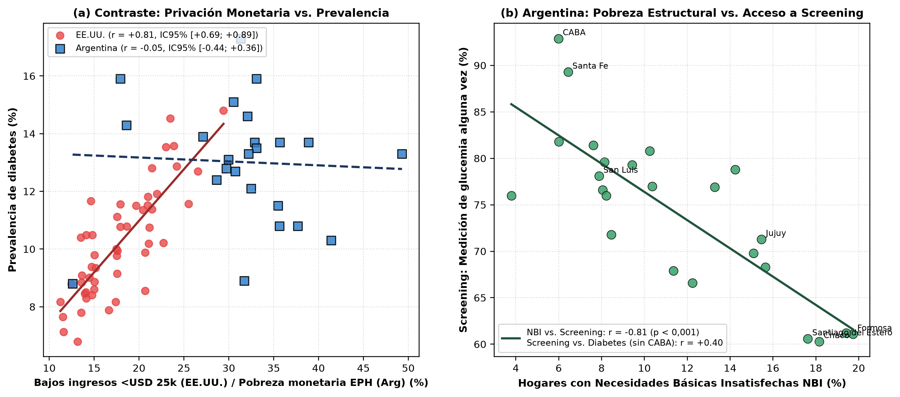

# Determinantes geoespaciales de la diabetes tipo 2 en la Argentina y los Estados Unidos: Salud basada en datos, cobertura de tratamiento y límites del modelado predictivo

**Geospatial Determinants of Type 2 Diabetes in Argentina and the United States: Health Data Science, Treatment Coverage, and Boundaries of Predictive Modeling**

**Autores:**  
María Florencia Rossi, Magali Bolivar, Matías Montiel, Roxana Martínez, Nestor Balich, Franco Balich  
*CAETI — Centro de Altos Estudios en Tecnología Informática*  
*Facultad de Tecnología Informática — Universidad Abierta Interamericana (UAI)*  
*Montes de Oca 745, Ciudad Autónoma de Buenos Aires, Argentina*  
*{MariaFlorencia.Rossi, MagaliFlorencia.BolivarCruz, MatiasNicolas.MontielTorres}@alumnos.uai.edu.ar*  
*{Roxana.Martinez, nestor.balich, francoadrian.balich}@uai.edu.ar*  

**Destino de Publicación:** XIV Congreso Internacional de Innovación y Tecnología Informática (CIITI 2026) / CoNaIISI  
**Repositorio Reproducible (Código y Datos):** `https://github.com/florr/Diabetes-Geografica-CIITI-2026`

---

### Resumen
La diabetes mellitus tipo 2 exhibe patrones territoriales heterogéneos modulados por los sistemas de salud. Este trabajo desarrolla un pipeline reproducible de ciencia de datos que compara los determinantes subnacionales de la enfermedad entre los 51 estados de los Estados Unidos (CDC BRFSS 2015, N=441.456 adultos ponderados) y las 24 jurisdicciones de la Argentina (4ª ENFR 2018 integrada con los Censos 2010/2022 y la EPH del INDEC). Los resultados sugieren una divergencia estructural: en los Estados Unidos, bajo un aseguramiento fragmentado de mercado, la prevalencia muestra fuerte autocorrelación espacial (I de Moran = +0,59; p < 0,001) y asociación lineal con los bajos ingresos (r = +0,81; IC95% [+0,69; +0,89]) y la inactividad física (r = +0,79), logrando un ajuste robusto en regresión OLS (R² = 0,891; LOOCV R² = 0,859) y Random Forest (5-Fold R² = 0,802). En contraste, en la Argentina la prevalencia provincial declarada (media 13,0%, DE 2,1%) no se asocia linealmente con la pobreza monetaria (r = -0,05; IC95% [-0,44; +0,36]; ρ = -0,19) ni con la falta de cobertura formal (r = -0,16). Este desacople es analizado junto a factores concurrentes (estructura etaria y error muestral CV ≤ 12,5%) bajo dos hipótesis sanitarias: primero, el posible subdiagnóstico en provincias con alta pobreza estructural NBI, las cuales registran menor screening glucémico (r = -0,81; p < 0,001), observándose que al excluir el outlier urbano de CABA (8,8% de prevalencia con 17,0% de obesidad y 92,9% de tamizaje) el screening correlaciona positivamente con la diabetes declarada (r = +0,40; p = 0,057); segundo, la ausencia de gradiente regresivo en el tratamiento farmacológico (r = -0,11; p = 0,62), donde jurisdicciones con más del 50% de población sin obra social (Santiago del Estero 56,0%, Formosa 55,9%, Chaco 52,2%) alcanzan coberturas terapéuticas del 54,2% al 62,6% mediante la red pública (Ley 26.914/PRODIABA y Programa Remediar), aunque persiste una brecha media nacional del 45,6%. Metodológicamente, con N=24 provincias tanto OLS (LOOCV R² = -0,701) como Ridge (R² = -0,311), regresiones univariadas (R² = -0,100) y Random Forest (5-Fold R² = -0,802) rinden por debajo de la media constante, sugiriendo priorizar atlas descriptivos y pesquisa activa frente al sobreajuste predictivo.

**Palabras clave:** diabetes mellitus; análisis comparativo; salud basada en datos; autocorrelación espacial; subdiagnóstico; cobertura de tratamiento; validación cruzada; determinantes sociales.

---

### Abstract
Type 2 diabetes mellitus exhibits heterogeneous spatial patterns shaped by healthcare system architecture. This study implements a reproducible health data science pipeline comparing subnational determinants across the 51 U.S. jurisdictions (CDC BRFSS 2015, N=441,456 weighted adults) and the 24 Argentine provinces (4th ENFR 2018 integrated with the 2010/2022 National Censuses and INDEC's EPH). Findings suggest a structural divergence: in the market-driven U.S. system, prevalence exhibits strong spatial autocorrelation (Moran's I = +0.59; p < 0.001) and linear association with low household income (r = +0.81; 95% CI [+0.69, +0.89]) and leisure-time inactivity (r = +0.79), enabling strong performance in multivariate OLS (R² = 0.891; LOOCV R² = 0.859) and Random Forest (5-Fold R² = 0.802). Conversely, in Argentina provincial self-reported prevalence (mean 13.0%, SD 2.1%) shows no linear association with monetary poverty (r = -0.05; 95% CI [-0.44, +0.36]; Spearman ρ = -0.19) or lack of insurance (r = -0.16). Alongside demographic age structure and survey sampling variability (CV ≤ 12.5%), two healthcare mechanisms are examined: first, potential underdiagnosis in high-NBI provinces with lower glycemic screening (r = -0.81; p < 0.001), noting that after excluding the CABA urban outlier (8.8% prevalence, 17.0% obesity, 92.9% screening), screening correlates positively with reported prevalence (r = +0.40; p = 0.057); second, the absence of a regressive gradient in pharmacological treatment (r = -0.11; p = 0.62), where provinces with >50% uninsured population (Santiago del Estero 56.0%, Formosa 55.9%, Chaco 52.2%) reach 54.2%–62.6% active treatment coverage through public programs (Law 26,914/PRODIABA and Remediar), despite a 45.6% mean national treatment gap. Methodologically, at N=24, multivariate OLS (LOOCV R² = -0.701), Ridge (R² = -0.311), univariate models (R² = -0.100), and Random Forest (5-Fold R² = -0.802) underperform the naive baseline, supporting descriptive geospatial atlases over fragile predictive models.

**Keywords:** diabetes mellitus; comparative analysis; health data science; spatial autocorrelation; underdiagnosis; treatment coverage; cross-validation; social determinants.

---

## 1. Introducción y Motivación

La diabetes mellitus tipo 2 se ha consolidado como una de las crisis sanitarias no transmisibles más relevantes a escala global [25]. Según las estimaciones de la 11.ª edición del International Diabetes Federation (IDF) Diabetes Atlas [1], los estudios poblacionales globales del consorcio NCD-RisC [2] y el Global Burden of Disease Study [3] publicados en The Lancet, más de 589 millones de adultos viven actualmente con la enfermedad en el mundo, proyectándose que esta cifra superará los 850 millones hacia el año 2050, mientras que las tasas globales de cobertura terapéutica permanecen rezagadas frente al crecimiento de la prevalencia [2], [3].

El impacto epidemiológico de la patología dista de manifestarse de manera homogénea en el territorio. Existe consenso interdisciplinario en torno a que los Determinantes Sociales de la Salud (DSS) [4], [5], [6] —tales como la disponibilidad de alimentos saludables, las condiciones materiales para la actividad física, la privación socioeconómica y el acceso efectivo a servicios diagnósticos y farmacológicos— modulan la distribución espacial de la morbimortalidad en las Américas [4], [16].

Desde la perspectiva de la ciencia de datos en salud (Health Data Science), un interrogante central consiste en evaluar si los patrones espaciales y los modelos predictivos formulados en economías desarrolladas con sistemas de salud privados son extrapolables a países de América Latina con sistemas públicos universales. Frecuentemente, la literatura de aprendizaje automático aplicado asume que los gradientes sociodemográficos observados en países anglosajones operan de forma análoga en cualquier latitud, soslayando el rol mediador de la arquitectura sanitaria.

Por una parte, los Estados Unidos constituyen el arquetipo de un sistema de salud fragmentado y dependiente del aseguramiento privado o laboral, donde la pesquisa bioquímica rutinaria está ampliamente extendida, pero la continuidad farmacológica (insulina e hipoglucemiantes) enfrenta severas barreras de copago y racionamiento por costo de bolsillo [6], [9], [10]. Por otra parte, la República Argentina sostiene un sistema mixto con un subsistema público de acceso universal y gratuito en el punto de atención, respaldado por la Guía de Práctica Clínica Nacional de DM2 [14], el marco normativo de cobertura integral de insulinas e insumos (PRODIABA / Ley N.º 26.914) y la distribución de hipoglucemiantes orales esenciales en centros de atención primaria mediante el Programa Nacional Remediar [15], aunque condicionado por marcadas asimetrías socioambientales y de infraestructura diagnóstica en el norte y las zonas rurales [13], [16], [17], [18].

El objetivo de este trabajo es implementar un pipeline reproducible de ciencia de datos para contrastar empíricamente la epidemiología geoespacial de la diabetes entre los 51 estados de los Estados Unidos y las 24 jurisdicciones de la Argentina. Específicamente se propone: (i) analizar la distribución cartográfica y la autocorrelación espacial (Índice I de Moran) de la prevalencia en ambos países; (ii) contrastar las asociaciones paramétricas (Pearson con intervalos de confianza al 95%) y no paramétricas (Spearman) entre privación socioeconómica y prevalencia declarada; (iii) examinar el rol del tamizaje glucémico (screening), la sensibilidad a valores extremos urbanos (CABA) y la cobertura farmacológica; y (iv) evaluar los límites de generalización fuera de muestra de modelos lineales, regularizados (Ridge) y no lineales (Random Forest) bajo esquemas simétricos de validación cruzada en muestras agregadas pequeñas (N=24).

---

## 2. Marco Conceptual y Antecedentes

El marco conceptual se apoya en el modelo de Determinantes Sociales de la Salud de la Organización Mundial de la Salud (OMS) [25] y de la American Diabetes Association (ADA) [4], [6], así como en revisiones recientes sobre desigualdades estructurales y territoriales en diabetes [5]. Este enfoque postula que las patologías cardiometabólicas responden a exposiciones acumulativas vinculadas a la estructura socioeconómica y a la organización territorial de los servicios preventivos.

En los Estados Unidos, la literatura epidemiológica reciente del CDC y estudios geoespaciales a gran escala como los de Benavidez et al. [7] y Wittman et al. [8] han documentado la persistencia de un corredor de alta prevalencia ('Cinturón de la Diabetes') en los Apalaches y el sudeste estadounidense (Misisipi, Alabama, Virginia Occidental, Luisiana). Estas investigaciones confirman a escala subnacional que la superposición de privación económica, menor nivel educativo, barreras financieras y sedentarismo explica la mayor parte de la variabilidad territorial de la diabetes diagnosticada en dicho país [5], [7], [8].

En la República Argentina, las investigaciones recientes en epidemiología espacial y sanitaria han documentado brechas regionales y urbanas persistentes. Marro et al. [16] demostraron mediante modelos multinivel la influencia determinante del entorno socioambiental y las desigualdades territoriales sobre la prevalencia de diabetes en aglomerados argentinos, mientras que Elgart et al. [17] relevaron las barreras operativas, psicosociales y terapéuticas que enfrentan los equipos de salud y los pacientes en el país. Asimismo, estudios clínicos en contextos rurales argentinos, como el de Ortiz-Basso et al. [18], han advertido sobre las barreras geográficas para el diagnóstico y control oftalmológico temprano.

En el plano metodológico, la ciencia de datos geoespaciales contemporánea (Rey, Arribas-Bel y Wolf [19]) enfatiza que el análisis de agregaciones jurisdiccionales está sujeto al Problema de la Unidad de Área Modificable (MAUP), a la dependencia espacial entre unidades vecinas y al riesgo de falacia ecológica. A ello se suma que en el aprendizaje estadístico supervisado [20] y en las guías internacionales de reporte y validación de modelos en salud (Varoquaux y Cheplygina [21]; guía TRIPOD+AI de Collins et al. [22]), entrenar modelos multiparamétricos cuando la razón de observaciones por predictor es reducida (v.g., N=24 provincias con 5 covariables) incrementa drásticamente la varianza del estimador fuera de muestra, exigiendo contrastar cualquier algoritmo contra modelos parsimoniosos, regularizados y estimadores de referencia (naive baseline).

---

## 3. Fuentes de Datos y Metodología

### 3.1. Microdatos de Estados Unidos (CDC BRFSS 2015)
Se procesaron los microdatos públicos del Behavioral Risk Factor Surveillance System (BRFSS, corte armonizado 2015 del repositorio plurianual del CDC [11]), compuestos por 441.456 entrevistas a adultos no institucionalizados de 18 años y más. Aplicando el factor de ponderación muestral oficial (_LLCPWT), que calibra por estructura etaria, sexo y raza/etnia, se agregaron los indicadores representativos de las 51 jurisdicciones (50 estados y Washington D.C.).

Se extrajeron: prevalencia de diabetes diagnosticada (variable DIABETE3, excluyendo diabetes gestacional y prediabetes declarada); obesidad autorreportada (IMC ≥ 30 kg/m², _BMI5CAT); inactividad física en el tiempo libre durante los últimos 30 días (_TOTINDA); porcentaje de adultos en hogares con ingresos anuales inferiores a USD 25.000 (INCOME2); adultos con educación secundaria incompleta (_EDUCAG); barrera económica para consultar al médico en el último año (MEDCOST); y adultos de 18 a 64 años sin seguro médico (_HCVU651).

### 3.2. Fuentes Oficiales de Argentina (ENFR e INDEC)
Para la República Argentina se construyó un dataset provincial de las 24 jurisdicciones (23 provincias y CABA) integrando los repositorios oficiales abiertos del INDEC [12], [13] y del Ministerio de Salud de la Nación [14], [15]:

1. 4ª Encuesta Nacional de Factores de Riesgo (ENFR, repositorio de microdatos y tabulados definitivos del INDEC [13]): Con representatividad para la población urbana de 18 años y más (N=29.224 hogares efectivos en aglomerados de ≥5.000 habitantes, representativos de ~29,5 millones de adultos urbanos dentro de una población total nacional de ~44 millones), se extrajeron de sus cuadros definitivos: prevalencia de diabetes o glucemia elevada autorreportada por diagnóstico previo de personal de salud (Cuadro 7.3) y su coeficiente de variación muestral (CV, todos ≤12,5%); cobertura de tratamiento farmacológico activo (pastillas o insulina) entre personas con diabetes (Cuadro 7.5); tasa de screening glucémico alguna vez en la vida (Cuadro 7.1); obesidad autorreportada IMC ≥ 30 (Cuadro 6.3); y prevalencia de nivel bajo de actividad física según el cuestionario internacional IPAQ (Cuadro 3.1).

2. Censo Nacional de Población, Hogares y Viviendas 2022 y serie censal histórica (INDEC) [12]: Se incorporó el porcentaje de hogares con Necesidades Básicas Insatisfechas (NBI, serie censal histórica de privación estructural); el porcentaje de población sin cobertura formal por obra social ni prepaga, dependiente exclusivamente del subsistema público (Censo 2022, Cuadro C1) [12]; y la densidad demográfica continental transformada en escala logarítmica (log10 hab/km²).

3. Encuesta Permanente de Hogares (EPH, base de pobreza monetaria del INDEC [13]): Se relevó la incidencia de pobreza monetaria de personas bajo la línea de pobreza (Cuadro 4.3), promediando los aglomerados urbanos de cada jurisdicción en sincronía temporal con el operativo de la ENFR.

### 3.3. Georreferenciación, Autocorrelación Espacial y Modelado Estadístico
El procesamiento geoespacial y econométrico se implementó en Python utilizando GeoPandas [23], SciPy, Statsmodels y Scikit-learn [24] siguiendo los estándares de ciencia de datos geográficos de Rey et al. [19] (el código fuente completo, los datos crudos y las tablas procesadas se encuentran abiertos en el repositorio reproducible del proyecto: https://github.com/florr/Diabetes-Geografica-CIITI-2026). Para evaluar formalmente la dependencia geográfica más allá de la inspección visual, se calculó el Índice I de Moran global de autocorrelación espacial [19] sobre las matrices de pesos de contigüidad tipo Reina (Queen, vinculando a Tierra del Fuego con su vecino continental más próximo) con inferencia por 9.999 permutaciones de Monte Carlo.

Para el análisis bivariado se reportan tanto el coeficiente paramétrico de Pearson (r) con sus intervalos de confianza al 95% (IC95% mediante transformación z de Fisher) como el coeficiente no paramétrico de rangos de Spearman (ρ), junto con un análisis de sensibilidad excluyendo a CABA (N=23) dado su carácter de valor extremo demográfico. En el modelado multivariado se estimaron regresiones por Mínimos Cuadrados Ordinarios (OLS) con errores estándar robustos a heterocedasticidad HC3 y Factores de Inflación de Varianza (VIF) [20].

Para responder a las exigencias de comparabilidad predictiva y prevención de sesgos de evaluación [20], [21], [22], todos los algoritmos supervisados se evaluaron de manera estrictamente simétrica en ambos países bajo dos esquemas libres de filtración de datos (data leakage): validación cruzada exhaustiva Leave-One-Out (LOOCV) y validación cruzada en 5 pliegues (5-Fold CV, barajado con semilla fija random_state=42). Asimismo, además de OLS multivariado (5 predictores) y Random Forest Regressor [24], se evaluaron especificaciones parsimoniosas y regularizadas: regresión Ridge con penalización L2 (α=10 con estandarización interna por pliegue) y regresión OLS univariada (empleando únicamente obesidad como predictor), contrastando el error cuadrático (MSE) y absoluto medio (MAE) contra el estimador naive baseline de media constante.

### 3.4. Comparabilidad de Constructos y Consideraciones Metodológicas
Resulta imperativo explicitar las diferencias operativas entre los constructos relevados en ambos países para evitar sobreafirmaciones en la comparación directa:

1. Diferencias en la definición de variables: (a) En el BRFSS (`DIABETE3`), la prevalencia excluye explícitamente la prediabetes declarada, mientras que la pregunta estandarizada de la ENFR (Cuadro 7.3) releva conjuntamente si un profesional médico le indicó tener 'diabetes o glucemia elevada'; esta mayor amplitud semántica contribuye a explicar por qué la media provincial argentina (13,0%) supera a la estadounidense (10,2%). (b) En actividad física, el BRFSS (`_TOTINDA`) mide la ausencia de ejercicio en el tiempo libre en el último mes (media 25,8%), mientras que la ENFR (Cuadro 3.1) clasifica el 'nivel bajo de actividad física' mediante el cuestionario multidominio IPAQ (media 46,2%); por ende, la brecha numérica entre ambos países refleja tanto hábitos poblacionales como instrumentos de medición distintos. (c) En privación económica y covariables de control, EE.UU. utiliza el umbral de ingresos familiares anuales menores a USD 25.000 y la tasa de educación secundaria incompleta, mientras que Argentina emplea la línea de pobreza monetaria de la EPH (canasta básica total regionalizada) y el logaritmo de la densidad poblacional (para capturar el contraste macrourbano de CABA, dado que el déficit educativo estructural ya integra el indicador censal de NBI). En las Tablas 2 y 4 ambos constructos se rotulan de forma diferenciada.

2. Estructura etaria, error muestral y potencia estadística: Los cuadros provinciales publicados de la ENFR reportan tasas brutas sin estandarización directa por edad y presentan coeficientes de variación muestral (CV) de entre 5,3% y 12,5% (lo que implica errores estándar de ~1,0 a 1,8 puntos porcentuales). Asimismo, con N=24 jurisdicciones, una correlación observada de r = -0,05 posee un IC95% amplio de [-0,44; +0,36]. En consecuencia, la ausencia de significancia estadística a escala ecológica no equivale a una prueba cerrada de independencia biológica, sino a la acción conjunta de sesgos de detección, confusión por estructura demográfica y variabilidad muestral.

---

## 4. Resultados

### 4.1. Atlas Geoespacial y Autocorrelación Espacial (I de Moran)

*Figura 1. Atlas geoespacial comparativo de la prevalencia de diabetes (%): (a) Estados Unidos (CDC BRFSS 2015, N=51; I de Moran = +0.59, p < 0,001); (b) República Argentina (ENFR 2018 / INDEC, N=24; I de Moran = +0.33, p = 0.039) con recuadro ampliado para CABA.*

La representación cartográfica bajo una escala común (6% a 18%, Figura 1) y las pruebas de autocorrelación espacial revelan patrones territoriales diferenciados. En los Estados Unidos (Figura 1a), la prevalencia media estatal es del 10.2% (DE 1.9%; mediana 10.0%), exhibiendo una autocorrelación espacial positiva altamente significativa (Índice I de Moran = +0.59; p < 0,001). Este agrupamiento confirma la consolidación geográfica del corredor de alta prevalencia en el sudeste y los Apalaches documentado en la literatura reciente [7], [8] (Misisipi 14,8%, Virginia Occidental 14,5%, Alabama 13,6%, Luisiana 12,9%), duplicando los registros de estados del oeste y norte como Colorado (6,8%) y Utah (7,1%).

En la República Argentina (Figura 1b), la media simple de las 24 jurisdicciones es del 13.0% (con desvío estándar muestral de 2.1% y desvío estándar poblacional de 2.06%, coherente con una varianza poblacional exacta de Var(y) = 4.24), mientras que el total nacional ponderado es del 12,7% [13]. La autocorrelación espacial resulta moderada (I de Moran = +0.33; p = 0.039), impulsada por valores elevados en Cuyo y la región pampeana occidental (San Luis 17,3%, San Juan 15,9%, La Rioja 15,1%, La Pampa 14,6%). Por el contrario, CABA registra el mínimo nacional (8,8%), seguida por provincias del norte con alta vulnerabilidad estructural como Jujuy (8,9%), Chaco (10,3%), Salta (10,8%) y Entre Ríos (10,8%).

---

### Tabla 1. Cuadro comparativo general de indicadores epidemiológicos, espaciales y sanitarios

| **Indicador** | **Estados Unidos (CDC BRFSS 2015)** | **Argentina (ENFR 2018 / INDEC)** |
| :--- | :---: | :---: |
| **N unidades territoriales** | 51 estados (50 + D.C.) | 24 jurisdicciones (23 + CABA) |
| **Población representada** | ~320 millones (441.456 enc. 18+) | ~44 mill. total (~29,5 mill. urbana 18+; N=29.224) |
| **Prevalencia media diabetes** | 10.2% (DE 1.9%; Mediana 10.0%) | 13.0% media prov. (DE 2.1%; 12,7% nac.) |
| **Rango de prevalencia** | 6.8% (Colorado) – 14.8% (Misisipi) | 8.8% (CABA) – 17.3% (San Luis) |
| **Autocorrelación espacial (I de Moran)** | I = +0.59 (p < 0,001; fuerte clustering) | I = +0.33 (p = 0.039; moderado) |
| **Prevalencia media obesidad (IMC≥30)** | 29.3% media est. (28,6% total nac.) | 26.7% media prov. (25,6% total nac.) |
| **Inactividad física / Baja act. (IPAQ)** | 25.8% tiempo libre (23,8% nac.) | 46.2% baja act. IPAQ (45,9% nac.) |
| **Población sin seguro médico formal** | 11.0% media est. (10,9% total nac.) | 37.3% media prov. (35,6% Censo 2022) |
| **Tasa de screening glucémico** | >85% (pesquisa clínica rutinaria) | Media 74.3% (60,3% Chaco a 92,9% CABA) |
| **Cobertura de tratamiento (y brecha)** | Barrera de costo médico / copago (media 13,2%) | Cobertura 53.9% [Brecha 46.1%] (32,7%–70,0%) |

---

### 4.2. Atlas de Factores Cardiometabólicos y Diferencias Operativas

*Figura 2. Distribución geoespacial de factores cardiometabólicos: (a) Obesidad en EE.UU.; (b) Obesidad en Argentina; (c) Inactividad física en tiempo libre en EE.UU. (_TOTINDA); (d) Baja actividad física en Argentina (IPAQ).*

La Figura 2 contrasta los factores de riesgo cardiometabólicos. En los Estados Unidos (Figuras 2a y 2c), la obesidad autorreportada promedia el 29.3% estatal (28,6% nacional) y la inactividad física en tiempo libre promedia el 25.8% (23,8% nacional), mostrando una estrecha correspondencia geográfica con el mapa de diabetes del sur profundo.

En la Argentina (Figuras 2b y 2d), la obesidad provincial promedia el 26.7% (25,6% nacional), con mínimo en CABA (17,0%) y máximos en San Juan (34,4%) y Santa Cruz (34,0%). En cuanto al indicador de baja actividad física relevado mediante cuestionario IPAQ (Figura 2d), la media provincial asciende al 46.2% (45,9% nacional), con picos en Formosa (69,1%) y La Rioja (61,2%). Como se advirtió en la Sección 3.4, si bien este indicador evidencia una alta prevalencia de hipocinesia en la Argentina, su magnitud absoluta no debe compararse de forma lineal con el indicador estadounidense debido a las diferencias metodológicas entre el instrumento multidominio IPAQ y la pregunta simple de ejercicio recreativo del BRFSS.

---

### 4.3. Correlaciones Paramétricas (IC95%), No Paramétricas (Spearman) y Regresión OLS

*Figura 3. Matrices de calor de correlaciones bivariadas de Pearson (r): (a) Estados Unidos (N=51); (b) República Argentina (N=24).*

### Tabla 2. Coeficientes de regresión lineal múltiple OLS con errores robustos HC3 y factores VIF

| **Determinante Sociodemográfico (Constructo específico por país)** | **EE.UU. Coef. β (HC3)** | **EE.UU. VIF** | **Argentina Coef. β (HC3)** | **Argentina VIF** |
| :--- | :---: | :---: | :---: | :---: |
| **Intercepto** | -1.475 (p=0.016) | — | +14.581 (p=0.133) | — |
| **Obesidad IMC≥30 (%)** | +0.180 (p=<0.001) | 2.2 | +0.053 (p=0.831) | 2.1 |
| **Inactividad T. Libre (US) / Baja Act. IPAQ (Arg) (%)** | +0.095 (p=0.026) | 2.5 | -0.002 (p=0.983) | 1.5 |
| **Ingresos <USD 25k (US) / Pobreza EPH (Arg) (%)** | +0.137 (p=0.004) | 4.0 | +0.017 (p=0.888) | 3.4 |
| **Sin Seguro 18–64 (US) / Sin OS ni Prepaga (Arg) (%)** | -0.096 (p=0.006) | 1.5 | -0.056 (p=0.555) | 3.4 |
| **Secundario Incompleto (US, %) / Densidad log10 (Arg)** | +0.202 (p=0.001) | 4.4 | -1.162 (p=0.397) | 2.4 |

El análisis correlacional (Figura 3 y Tabla 2) expone un marcado contraste entre ambos países. En los Estados Unidos (N=51), tanto las correlaciones lineales de Pearson como las de rangos de Spearman confirman un fuerte gradiente socioeconómico positivo: la proporción de hogares con bajos ingresos (<USD 25k) se asocia a la diabetes con r = +0.81 (p < 0,001; IC95% [+0.69; +0.89]; Spearman ρ = +0.80), la inactividad física con r = +0.79 (p < 0,001; IC95% [+0.65; +0.87]; ρ = +0.74), la educación secundaria incompleta con r = +0.77 (p < 0,001; IC95% [+0.63; +0.86]; ρ = +0.81) y la obesidad con r = +0.75 (p < 0,001; IC95% [+0.60; +0.85]; ρ = +0.70). En el modelo OLS multivariado con errores robustos HC3 [20] (Tabla 2), la obesidad (β = +0,180; p < 0,001), los bajos ingresos (β = +0,137; p = 0,004), el secundario incompleto (β = +0,202; p = 0,001) y la inactividad física (β = +0,095; p = 0,026) conservan significancia estadística con factores VIF controlados (<5) y un ajuste global de R² = 0.891 (R²_adj = 0.878; F = 73.3; p < 0,001).

En contrapartida, en la República Argentina (N=24) la prevalencia provincial declarada no exhibe asociación lineal ni monótona positiva con los indicadores de privación: la pobreza monetaria EPH arroja r = -0.05 (p = 0.82; IC95% [-0.44; +0.36]; Spearman ρ = -0.19, p = 0.38), las Necesidades Básicas Insatisfechas (NBI) registran r = -0.22 (p = 0.30; IC95% [-0.57; +0.20]; ρ = -0.19) y la proporción de población sin cobertura de obra social ni prepaga muestra r = -0.16 (p = 0.47; IC95% [-0.53; +0.26]; ρ = -0.22). Incluso la obesidad presenta una asociación bivariada moderada y no significativa al 5% (r = +0.34; p = 0.11; IC95% [-0.08; +0.65]). En la regresión múltiple OLS (Tabla 2), ningún regresor resulta estadísticamente significativo y el modelo global carece de significancia conjunta (F = 1.29; p = 0.31; R² = 0.264; R²_adj = 0.059).

---

### 4.4. Detección, Sensibilidad al Outlier CABA, Factores Concurrentes y Tratamiento

*Figura 4. Cobertura y barreras asistenciales: (a) Cobertura provincial de tratamiento farmacológico activo en Argentina (media 53.9%, brecha 46.1%); (b) Barrera de costo médico vs. prevalencia en EE.UU.*

Para comprender por qué las provincias argentinas con mayor privación estructural no registran mayores tasas de diabetes autorreportada, el análisis empírico evalúa los eslabones de detección (screening), el efecto de valores extremos (CABA), las explicaciones demográficas/muestrales alternativas y la cobertura de tratamiento (Figuras 4 y 5b):

1. Hipótesis del subdiagnóstico, correlación entre screening y prevalencia, y el rol de CABA: En la Argentina, el acceso al tamizaje glucémico presenta una fuerte autocorrelación espacial (I de Moran = +0.37; p = 0.023) y una intensa asociación lineal inversa con la pobreza estructural NBI: r = -0.81 (p < 0,001; IC95% [-0.91; -0.60]; Spearman ρ = -0.78; Figura 5b). Mientras en CABA (92,9%) y Santa Fe (89,3%) nueve de cada diez adultos han sido pesquisados, en Chaco (60,3%), Santiago del Estero (60,6%) y Formosa (61,1%) cerca del 40% de los adultos jamás se midió la glucemia [13]. Ahora bien, al evaluar directamente el segundo eslabón —la correlación entre screening y prevalencia declarada— sobre las 24 jurisdicciones completas se obtiene r = +0.13 (p = 0.55; IC95% [-0.29; +0.51]). La razón por la cual esta correlación resulta atenuada es la presencia de CABA como outlier demográfico y epidemiológico: CABA combina el mayor screening del país (92,9%) con la menor prevalencia (8,8%), pero ello obedece a que posee simultáneamente la menor tasa de obesidad nacional (17,0% frente a 26,7% de media provincial), baja inactividad física (32,4%) y mínima pobreza (12,6%). Al realizar el análisis de sensibilidad excluyendo a CABA (N=23 provincias), la correlación entre screening y prevalencia declarada asciende a r = +0.40 (p = 0.057; IC95% [-0.01; +0.70]; Spearman ρ = +0.35): en el interior del país, las jurisdicciones que más testean tienden a detectar mayor prevalencia, mientras que provincias como Jujuy (31,1% de obesidad pero solo 71,3% de screening y 8,9% de diabetes declarada) o Chaco (60,3% de screening y 10,3% de diabetes) sugieren una subcaptación por falta de pesquisa.

2. Explicaciones concurrentes (estructura etaria y error muestral): Los datos agregados no permiten afirmar que el subdiagnóstico sea el único causante de la distribución provincial. En primer lugar, las prevalencias del Cuadro 7.3 de la ENFR no se encuentran estandarizadas por edad; dado que las provincias del NEA y NOA poseen pirámides poblacionales más jóvenes que las jurisdicciones pampeanas y cuyanas [12], la menor edad media atenúa genuinamente la prevalencia bruta en el norte. En segundo lugar, el error muestral de la encuesta (con CV de hasta 12,5% en Santiago del Estero y 12,3% en La Rioja) introduce intervalos de incertidumbre que solapan parte de las diferencias interprovinciales.

3. Cobertura vs. brecha de tratamiento farmacológico y rol del subsistema público: Entre las personas diagnosticadas, la cobertura media provincial de tratamiento farmacológico activo en la Argentina es del 53.9% (equivalente a una brecha media sin tratamiento farmacológico del 46.1%, con rango de cobertura entre 32,7% en La Pampa y 70,0% en Santa Cruz y Tierra del Fuego; Figura 4a). A diferencia de los Estados Unidos —donde la barrera económica de costo médico correlaciona positivamente con la carga de enfermedad (r = +0.66; p < 0,001; Figura 4b) y propicia el racionamiento de insulina documentado en encuestas nacionales recientes [9], [10]—, en la Argentina no se observa una correlación regresiva entre el porcentaje de población sin obra social ni prepaga y la cobertura de tratamiento farmacológico: r = -0.11 (p = 0.62; IC95% [-0.49; +0.31]; Spearman ρ = +0.01). En efecto, las tres jurisdicciones del país que superan el 50% de población dependiente exclusivamente del hospital público —Santiago del Estero (56,0% sin cobertura formal), Formosa (55,9%) y Chaco (52,2%)— alcanzan tasas de tratamiento activo del 59,7%, 62,6% y 54,2% respectivamente, superando el promedio nacional. Por su parte, las máximas coberturas patagónicas (Santa Cruz y Tierra del Fuego, ambas con 70,0%) responden a una combinación de alta cobertura de seguridad social formal (solo 17,0% y 15,3% sin cobertura en el Censo 2022 [12]) y redes hospitalarias públicas provinciales, mientras que distritos pampeanos o patagónicos extensos con menor pobreza como La Pampa (32,7% de tratamiento y 32,1% sin cobertura) o Chubut (38,3% de tratamiento y 27,8% sin cobertura) evidencian importantes brechas de adherencia vinculadas a dispersión territorial y seguimiento clínico [17]. Esta evidencia sugiere que la provisión estatal de metformina y glibenclamida en atención primaria a través del Programa Remediar y la cobertura legal del 100% de insulinas e insumos dispuesta por la Ley N.º 26.914 (PRODIABA) [15] amortiguan la desigualdad socioeconómica entre quienes logran ser diagnosticados, si bien persiste un desafío sanitario sustantivo para cubrir el 46.1% promedio de pacientes diagnosticados sin tratamiento farmacológico continuo.

---

### 4.5. Evaluación Predictiva Simétrica y Modelos Parsimoniosos/Regularizados

*Figura 5. Diagnóstico de determinantes y tamizaje: (a) Regresión lineal Privación monetaria vs. Prevalencia con IC95%; (b) Argentina: Correlación inversa entre NBI y Screening (r = -0.81; p < 0,001).*

### Tabla 3. Evaluación comparativa simétrica in-sample y fuera de muestra (LOOCV y 5-Fold CV)

| **Modelo y Esquema de Evaluación** | **EE.UU. R²** | **EE.UU. MAE** | **Argentina R²** | **Argentina MAE** | **Diagnóstico Metodológico** |
| :--- | :---: | :---: | :---: | :---: | :---: |
| **Estimador Naive Baseline (Media constante ȳ)** | 0.000 | 1.53% | 0.000 | 1.59% | Referencia base (R²=0): dispersión intrínseca Var(y)=4.24 (DE=2.06%) |
| **OLS Multivariado 5 vars (In-Sample, muestra completa)** | 0.891 (adj 0.878) | 0.50% | 0.264 (adj 0.059) | 1.44% | EE.UU. significativo (F=73.3, p<0.001); Arg no significativo (F=1.29, p=0.31) |
| **OLS Multivariado 5 vars (LOOCV / 5-Fold CV)** | 0.859 / 0.842 | 0.56% / 0.59% | -0.701 / -1.294 | 2.12% / 2.43% | Sobreajuste severo en Arg (MSE LOOCV=7.21 > Var(y)=4.24) |
| **Regresión Regularizada Ridge α=10 (LOOCV / 5-Fold CV)** | 0.858 / 0.856 | 0.58% / 0.58% | -0.311 / -0.429 | 1.87% / 1.97% | La penalización L2 atenúa la varianza en Arg pero mantiene R²_CV < 0 |
| **OLS Parsimonioso 1 predictor: Obesidad (LOOCV / 5-Fold)** | 0.532 / 0.521 | 1.02% / 1.03% | -0.100 / -0.023 | 1.58% / 1.56% | Incluso con 1 solo predictor sin sobreparametrización no hay señal en Arg (R²<0) |
| **Random Forest Regressor (LOOCV / 5-Fold CV)** | 0.815 / 0.802 | 0.67% / 0.66% | -0.657 / -0.802 | 2.07% / 2.20% | Sólida generalización en EE.UU.; fallo fuera de muestra en Arg en ambos esquemas |

---

### Tabla 4. Ranking de jurisdicciones extremas en prevalencia

| **Grupo Extremo** | **Jurisdicción** | **Diabetes (%)** | **Ingresos <USD 25k (US) / Pobreza EPH (Arg)** | **Dato Clave** |
| :--- | :---: | :---: | :---: | :---: |
| **EE.UU. — Mayor Prevalencia (1)** | Mississippi | 14.8% | 29.4% | Cinturón de Diabetes (Sur profundo) |
| **EE.UU. — Mayor Prevalencia (2)** | West Virginia | 14.5% | 23.5% | Apalaches; inactividad 30.8% |
| **EE.UU. — Menor Prevalencia (1)** | Colorado | 6.8% | 13.2% | Mayor ingreso relativo y actividad física |
| **EE.UU. — Menor Prevalencia (2)** | Utah | 7.1% | 11.6% | Baja prevalencia de obesidad y tabaquismo |
| **Argentina — Mayor Prevalencia (1)** | San Luis | 17.3% | 31.3% | Región Cuyo (máximo nacional ENFR 2018) |
| **Argentina — Mayor Prevalencia (2)** | San Juan | 15.9% | 33.1% | Máxima obesidad nacional (34.4%) |
| **Argentina — Menor Prevalencia (1)** | CABA | 8.8% | 12.6% | Menor obesidad (17,0%) y máx. screening (92.9%) |
| **Argentina — Menor Prevalencia (2)** | Jujuy | 8.9% | 31.7% | Obesidad 31,1% pero bajo screening (71.3%) |

La Tabla 3 presenta la evaluación simétrica de los algoritmos supervisados mediante LOOCV y 5-Fold CV en ambos países frente al estimador naive baseline. En los Estados Unidos (N=51), la intensa señal lineal permite que tanto el modelo OLS multivariado (R² in-sample = 0.891; LOOCV R² = 0.859; 5-Fold R² = 0.842) como la regresión regularizada Ridge (LOOCV R² = 0.858; 5-Fold R² = 0.856) y el ensamble de Random Forest [20], [24] (LOOCV R² = 0.815; 5-Fold R² = 0.802) reduzcan el error absoluto medio desde el baseline de 1.53% a un rango de 0,56%–0,67% fuera de muestra. Incluso una especificación parsimoniosa univariada con un solo predictor (obesidad) retiene más del 52% de varianza explicada fuera de muestra (LOOCV R² = 0.532).

Por el contrario, en las 24 jurisdicciones argentinas, el predictor ingenuo de media constante (ȳ = 13.0%) establece un umbral base de R² = 0,000 con MAE = 1.59% y MSE_baseline = Var(y) = 4.24. Al evaluar el modelo OLS de 5 predictores fuera de muestra, el MSE en LOOCV asciende a 7.21 (MAE = 2.12%), superando en un 70,1% a la varianza intrínseca de la serie (7.21 / 4.24 = 1,701) y arrojando R²_LOOCV = -0.701 (y R²_5Fold = -1.294). De igual modo, Random Forest obtiene R²_LOOCV = -0.657 y R²_5Fold = -0.802.

Para verificar si este resultado responde meramente al exceso de parámetros (5 predictores para N=24 observaciones), se evaluaron dos alternativas parsimoniosas (Tabla 3): una regresión Ridge con fuerte penalización L2 (α=10) y un modelo OLS bivariado con un único predictor (obesidad). Si bien la regularización Ridge reduce el sobreajuste respecto al OLS sin penalizar (mejorando el R²_LOOCV de -0.701 a -0.311, con MAE = 1.87%) y el modelo univariado alcanza R²_LOOCV = -0.100 (MAE = 1.58%), absolutamente todas las especificaciones arrojan R² fuera de muestra negativos en ambos esquemas de validación cruzada. Esto evidencia, en línea con las advertencias metodológicas de Varoquaux y Cheplygina [21], que en la agregación provincial argentina la limitación no radica únicamente en la relación parámetros-muestra, sino en la ausencia de señal lineal entre las covariables ecológicas y la prevalencia autorreportada, sugiriendo la conveniencia de evitar el ajuste acrítico de modelos predictivos sobre agregados pequeños con sesgos de medición.

---

## 5. Discusión

### 5.1. Implicancias para la Gestión y las Políticas Públicas
Los resultados obtenidos sugieren implicancias diferenciadas para la gestión sanitaria en ambos países. En los Estados Unidos, donde el tamizaje clínico se encuentra generalizado pero la privación socioeconómica y la barrera de costo médico se asocian fuertemente con la carga de la enfermedad [5], [7], las prioridades de política pública se orientan a regular el precio de bolsillo de la insulina y reducir los copagos que inducen al racionamiento terapéutico [9], [10].

En la República Argentina, la evidencia ecológica sugiere una doble prioridad territorial: (i) en las provincias del NEA y NOA con elevado NBI, donde cerca del 40% de los adultos nunca accedió a una medición de glucemia [13], resulta prioritario fortalecer operativos de pesquisa activa capilar y bioquímica en el primer nivel de atención conforme a la Guía de Práctica Clínica Nacional [14] para reducir el subdiagnóstico; y (ii) en materia terapéutica, si bien la red pública respaldada por el Programa Remediar (provisión de metformina y glibenclamida en centros de atención primaria) y la Ley N.º 26.914 / PRODIABA (cobertura legal del 100% de insulinas y tiras reactivas) [15] evita que las provincias con mayor proporción de población sin obra social queden rezagadas, la existencia de una brecha nacional promedio del 45,6% de pacientes diagnosticados sin tratamiento farmacológico activo —con valores críticos en provincias extensas como La Pampa (67,3% de brecha) y Chubut (61,7%)— exige auditar la continuidad de seguimiento clínico y el acceso logístico en todo el territorio.

### 5.2. Aportes Metodológicos y Limitaciones del Estudio
Desde una perspectiva metodológica, este estudio aporta una reflexión empírica alineada con los estándares TRIPOD+AI [22] sobre el uso de modelos supervisados en epidemiología espacial. Cuando el tamaño muestral de unidades geográficas es reducido (N=24) y la variable dependiente autorreportada se encuentra sujeta a sesgos de detección, variabilidad muestral y confusión demográfica, tanto los modelos lineales multiparamétricos como los ensambles de árboles sobreajustan el ruido local y empeoran el pronóstico respecto a la media histórica [21]. En tales escenarios, el valor de la ciencia de datos reside en la construcción de atlas geoespaciales descriptivos, el análisis de autocorrelación espacial y la integración transparente de fuentes oficiales [19].

Finalmente, deben sintetizarse con rigor las limitaciones del estudio: (i) el carácter ecológico de las regresiones impide realizar inferencias causales individuales (falacia ecológica) y está condicionado por la delimitación político-administrativa provincial (MAUP) [19]; (ii) la presencia de autocorrelación espacial positiva en la prevalencia (I de Moran = +0,59 en EE.UU. y +0,33 en Argentina) implica que las jurisdicciones vecinas no son estrictamente independientes, lo cual motiva el empleo futuro de modelos autorregresivos espaciales (SAR/SEM) [19]; (iii) las tasas provinciales de la ENFR carecen de estandarización por edad y presentan errores muestrales (CV de hasta 12,5%) e intervalos de confianza amplios por el tamaño muestral (N=24); (iv) existen diferencias operativas en los instrumentos de medición entre ambas encuestas (inclusión de 'glucemia elevada' y cuestionario IPAQ en la ENFR frente a diagnóstico estricto e inactividad recreativa en el BRFSS) y desfasajes temporales entre cortes censales y encuestas; y (v) la asociación entre NBI, screening y prevalencia constituye una evidencia ecológica compatible con el subdiagnóstico, pero su cuantificación definitiva requiere analizar mediciones bioquímicas directas.

---

## 6. Conclusiones y Trabajos Futuros

Se desarrolló un pipeline reproducible de ciencia de datos que contrastó los determinantes territoriales de la diabetes mellitus entre los Estados Unidos (N=51) y la República Argentina (N=24). Los resultados sugieren que mientras en los Estados Unidos la prevalencia sigue un marcado agrupamiento espacial (I de Moran = +0.59) y un gradiente socioeconómico lineal (r = +0.81 con bajos ingresos; R² OLS = 0.891), en la Argentina la prevalencia declarada no correlaciona linealmente con la pobreza monetaria (r = -0.05; IC95% [-0.44; +0.36]). El análisis territorial sugiere que este comportamiento responde a la conjunción de factores demográficos y muestrales con un severo déficit de tamizaje en las provincias de mayor NBI (r = -0.81 entre NBI y screening; y r = +0.40 entre screening y diabetes al excluir el outlier de CABA), mientras que el subsistema público atenúa la regresividad en el acceso a fármacos entre los diagnosticados (r = -0.11), aun cuando persiste una brecha nacional del 46.1% sin tratamiento activo.

En el plano computacional, la evaluación cruzada simétrica evidenció que con N=24 jurisdicciones y ausencia de señal lineal, tanto OLS multivariado (LOOCV R² = -0.701) como Ridge (R² = -0.311), modelos univariados (R² = -0.100) y Random Forest (5-Fold R² = -0.802) exhiben desempeño predictivo negativo frente a la media constante, respaldando el uso de atlas geoespaciales descriptivos.

Como líneas de trabajo futuro que superen directamente las limitaciones ecológicas actuales se proyecta: (i) procesar los microdatos individuales públicos de la ENFR [13] incorporando la edad, el sexo y los factores de expansión a nivel persona mediante modelos multinivel jerárquicos (individuo-provincia) en línea con el enfoque de Marro et al. [16] y estandarización directa por estructura etaria; (ii) integrar las submuestras bioquímicas de glucemia capilar y hemoglobina glicosilada de la ENFR (Cuadros 7.9–7.11) para medir empíricamente la brecha entre diabetes autorreportada y diabetes biológica no diagnosticada; y (iii) estimar modelos econométricos espaciales (Spatial Lag y Spatial Error Models) [19] que incorporen explícitamente la matriz de vecindad geográfica.

---

## Referencias

* [1] International Diabetes Federation, "IDF Diabetes Atlas", 11.ª ed., Bruselas: IDF, 2024. [En línea]. Disponible: https://diabetesatlas.org
* [2] NCD Risk Factor Collaboration (NCD-RisC), "Worldwide trends in diabetes prevalence and treatment from 1990 to 2022: a pooled analysis of 1108 population-representative studies with 141 million participants", The Lancet, vol. 404, n.º 10467, pp. 2077–2093, 2024.
* [3] K. L. Ong et al. (GBD 2021 Diabetes Collaborators), "Global, regional, and national burden of diabetes from 1990 to 2021, with projections of prevalence to 2050: a systematic analysis for the Global Burden of Disease Study 2021", The Lancet, vol. 402, n.º 10397, pp. 203–234, 2023.
* [4] F. Hill-Briggs y S. L. Fitzpatrick, "Overview of Social Determinants of Health in the Development of Diabetes", Diabetes Care, vol. 46, n.º 9, pp. 1590–1598, 2023.
* [5] L. E. Egede, J. A. Campbell, R. J. Walker y S. Linde, "Structural Racism as an Upstream Social Determinant of Diabetes Outcomes: A Scoping Review", Diabetes Care, vol. 46, n.º 4, pp. 667–677, 2023.
* [6] American Diabetes Association Professional Practice Committee, "1. Improving Care and Promoting Health in Populations: Standards of Care in Diabetes—2024", Diabetes Care, vol. 47, Suppl. 1, pp. S11–S19, 2024.
* [7] G. A. Benavidez, W. E. Zahnd, P. Hung y J. M. Eberth, "Chronic Disease Prevalence in the US: Sociodemographic and Geographic Variations by Zip Code Tabulation Area", Preventing Chronic Disease, vol. 21, art. 230267, 2024.
* [8] J. T. Wittman, D. S. Alexander, M. Bing, R. Montierth, H. Xie, S. R. Benoit y K. McKeever Bullard, "Identifying Priority Geographic Locations for Diabetes Self-Management Education and Support Services in the Appalachian Region", Preventing Chronic Disease, vol. 21, art. 230297, 2024.
* [9] A. Gaffney, D. U. Himmelstein y S. Woolhandler, "Prevalence and Correlates of Patient Rationing of Insulin in the United States: A National Survey", Annals of Internal Medicine, vol. 175, n.º 11, pp. 1623–1626, 2022.
* [10] M. Fang y E. Selvin, "Cost-Related Insulin Rationing in US Adults Younger Than 65 Years With Diabetes", JAMA, vol. 329, n.º 19, pp. 1700–1702, 2023.
* [11] Centers for Disease Control and Prevention (CDC), "Behavioral Risk Factor Surveillance System (BRFSS) and PLACES: Local Data for Better Health", Atlanta: U.S. Department of Health and Human Services, 2024. [En línea]. Disponible: https://www.cdc.gov/brfss
* [12] Instituto Nacional de Estadística y Censos (INDEC), "Censo Nacional de Población, Hogares y Viviendas 2022: Resultados definitivos de cobertura de salud y condiciones habitacionales", Buenos Aires: INDEC, 2023.
* [13] Instituto Nacional de Estadística y Censos (INDEC), "Bases de microdatos y cuadros estadísticos de la Encuesta Nacional de Factores de Riesgo (ENFR) y Encuesta Permanente de Hogares (EPH)", Buenos Aires: INDEC, 2023. [En línea]. Disponible: https://www.indec.gob.ar
* [14] Ministerio de Salud de la Nación Argentina, "Guía de Práctica Clínica Nacional sobre Prevención, Diagnóstico y Tratamiento de la Diabetes Mellitus Tipo 2 (DM2) — Resolución Ministerial N.º 3877/2023", Buenos Aires: Dirección Nacional de Abordaje Integral de Enfermedades No Transmisibles, 2023.
* [15] Ministerio de Salud de la Nación Argentina, "Programa Nacional Remediar y PRODIABA (Ley N.º 26.914): Provisión gratuita de medicamentos esenciales e insumos en el Primer Nivel de Atención", Buenos Aires: Ministerio de Salud de la Nación, 2023.
* [16] M. J. Marro, M. de J. Mendes da Fonseca, I. da Costa Leite, C. Ballejo y M. Alazraqui, "Un retorno al ambiente en epidemiología: análisis multinivel de la diabetes mellitus en un gran aglomerado urbano de Argentina", Revista Brasileira de Epidemiologia, vol. 29, e260043, 2026.
* [17] J. F. Elgart, E. Rucci y J. J. Gagliardino, "Visión epidemiológica, psicosocial y terapéutica de la diabetes mellitus en Argentina desde las perspectivas del equipo de salud y de las personas con diabetes", Revista de la Sociedad Argentina de Diabetes, vol. 56, n.º 1, pp. 31–37, 2022.
* [18] T. Ortiz-Basso, B. R. Boietti, P. V. Gómez, A. D. Boffelli y A. A. Paladini, "Prevalencia de retinopatía diabética en una zona rural de Argentina", Medicina (Buenos Aires), vol. 82, n.º 1, pp. 99–103, 2022.
* [19] S. J. Rey, D. Arribas-Bel y L. J. Wolf, "Geographic Data Science with Python", Boca Raton: CRC Press / Chapman & Hall, 2023.
* [20] G. James, D. Witten, T. Hastie, R. Tibshirani y J. Taylor, "An Introduction to Statistical Learning: with Applications in Python", Cham: Springer, 2023.
* [21] G. Varoquaux y V. Cheplygina, "Machine learning for medical imaging: methodological failures and recommendations for the future", npj Digital Medicine, vol. 5, n.º 1, art. 48, 2022.
* [22] G. S. Collins, K. G. M. Moons, P. Dhiman et al., "TRIPOD+AI statement: updated guidance for reporting clinical prediction models that use regression or machine learning methods", BMJ, vol. 385, e078378, 2024.
* [23] K. Jordahl et al., "GeoPandas: Python tools for geographic data (v1.0)", Zenodo, 2024. [En línea]. Disponible: https://geopandas.org
* [24] Scikit-learn Developers, "Scikit-learn: Machine Learning in Python (v1.5 Documentation)", 2024. [En línea]. Disponible: https://scikit-learn.org
* [25] World Health Organization (WHO), "Global Diabetes Compact and Noncommunicable Diseases Progress Monitor", Ginebra: Organización Mundial de la Salud, 2022.
